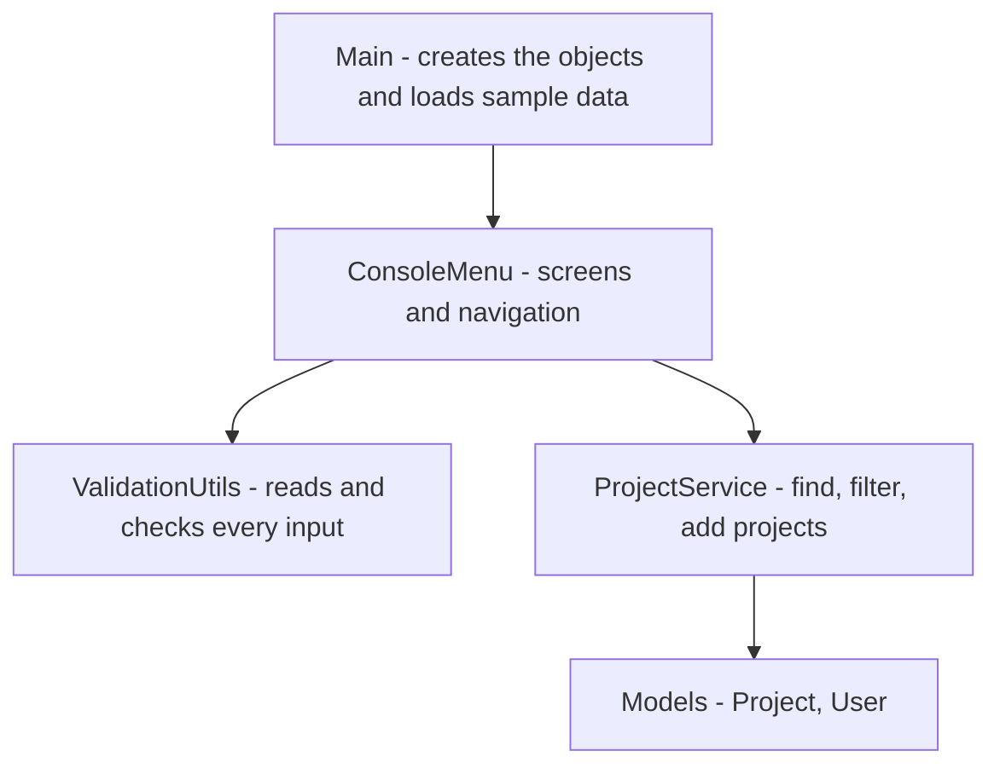
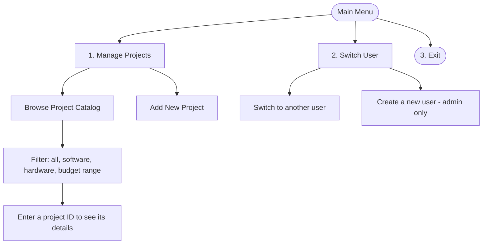

# Project Hub

A small console application written in Java 21 to manage a catalog of software and hardware projects and the users who work on them. Only admins can change data.

This project is my individual assessment for **Agile & DevOps in Practice**. The starting code was a bigger task management system. Its scope was reduced to **users and projects only**, so the focus stays on the Agile and DevOps practices. The planning documents are in [docs/agile](docs/agile).

All data lives in memory, so nothing is saved when the program closes.

## How to run

**Requirements:** JDK 21 and IntelliJ IDEA (or any terminal with `javac`).

In IntelliJ: open the project folder, set the SDK to JDK 21, mark `src` as the sources root and run `Main`.

From a terminal, in the project root:

```
javac -encoding UTF-8 -d out src/Main.java src/models/*.java src/services/*.java src/utils/*.java
java -Dstdout.encoding=UTF-8 -cp out Main
```

When the program starts you are logged in as **Admin**. **Josephus Mupanda (Regular)** also exists, and five sample projects are loaded.

## How the program is organised



## Using the application



IDs are shown with a prefix: `PRJ001` for projects and `U001` for users. When the program asks for an ID you can type `PRJ001` or just `1`.

## Roles and permissions

| Action | Regular | Admin |
|---|---|---|
| Browse and search projects | yes | yes |
| Add projects | yes | yes |
| Create users | no | yes |

## Project structure

```
src/
  Main.java                  entry point and sample data
  models/
    Project.java             abstract
    SoftwareProject.java
    HardwareProject.java
    User.java                abstract
    RegularUser.java
    AdminUser.java
  services/
    ProjectService.java
  utils/
    ConsoleMenu.java
    ValidationUtils.java
docs/
  agile/                     sprint planning, reviews and retrospectives
  design-decisions.md
```

## More documentation

- [Sprint 0 planning](docs/agile/sprint-0-planning.md): vision, backlog, acceptance criteria, Definition of Done.
- [Design decisions](docs/design-decisions.md): why the classes are shaped this way.
