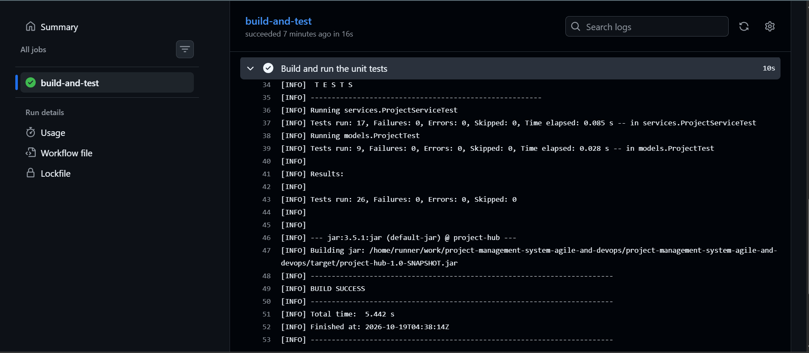
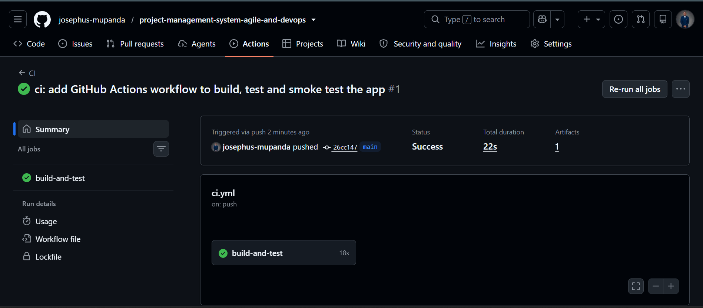

# Sprint 1 – Review

**Sprint goal:** set up the DevOps foundation (build, tests, CI) and let admins keep the project catalog correct.

**Result:** goal reached. 8 of 8 committed story points delivered, plus the 2 enablers.

## Delivered items

| Item | Points | Status |
|---|---|---|
| EN-02 – Maven and JUnit 5 | – | Done |
| EN-03 – GitHub Actions CI | – | Done |
| US-01 – Update project details | 5 | Done |
| US-02 – Delete a project | 3 | Done |

## Acceptance criteria check

Each criterion was checked by hand in the console, and the logic behind it is covered by unit tests.

### US-01 – Update project details

| # | Criterion | Result |
|---|---|---|
| 1 | Admin can enter a new name, description, budget, team size and duration | Passed: "Budget Buddy" renamed to "Budget Buddy Pro", budget 8,000 → 9,000 |
| 2 | Pressing Enter keeps the current value | Passed: description, team size and duration unchanged |
| 3 | A name used by another project is refused and asked again | Passed: "Smart Garden Monitor" refused |
| 4 | Budget, team size or duration of 0 or less is refused | Passed: "-5" refused for budget |
| 5 | A regular user gets "Access denied" | Passed |

### US-02 – Delete a project

| # | Criterion | Result |
|---|---|---|
| 1 | Admin confirms with `y` and the project is removed | Passed: `Project "Smart Garden Monitor" deleted.` |
| 2 | Answering `n` deletes nothing | Passed: `Nothing was deleted.` |
| 3 | Deleted project leaves the catalog and its ID is never reused | Passed: catalog went from 5 to 4 projects, next new project got PRJ006 |
| 4 | A regular user gets "Access denied" | Passed |

## Demo script

1. Start the app (logged in as Admin) → `1. Manage Projects` → `1. Browse Project Catalog` → `1. View All Projects`.
2. Type `PRJ001` → `1. Update Project` → type `Smart Garden Monitor` (refused), then `Budget Buddy Pro`, press Enter for the rest. The details now show the new name.
3. Choose `2. Delete Project` → `n` (nothing happens) → `2. Delete Project` → `y`. The catalog now shows 4 projects.
4. `2. Switch User` → `1` → `U002` (regular user) → try to update or delete a project → "Access denied".

## Testing evidence

| Test class | Tests | Result |
|---|---|---|
| `models.ProjectTest` | 9 | All passed |
| `services.ProjectServiceTest` | 17 | All passed |
| **Total** | **26** | **0 failures, 0 errors** |

## CI/CD evidence

The pipeline in [.github/workflows/ci.yml](../../.github/workflows/ci.yml) runs on every push: build, unit tests, smoke test (start the app and exit) and upload of the test reports. Every push in Sprint 1 was green.

## Commit history for the sprint

| Commit | Message |
|---|---|
| `ee8a7d1` | build: add Maven with JUnit 5 and first unit tests for project models |
| `a2ccffa` | test: add unit tests for ProjectService search, filters and duplicates |
| `26cc147` | ci: add GitHub Actions workflow to build, test and smoke test the app |
| `057b615` | feat(US-01): let admins update a project's details |
| `a297367` | test(US-01): cover project update rules and duplicate name checks |
| `0412dad` | feat(US-02): let admins delete a project with confirmation |
| `febb580` | test(US-02): cover project deletion and id reuse rules |

## Velocity

| Committed | Delivered |
|---|---|
| 8 points | 8 points |

This gives a reference velocity of **8 points** for planning Sprint 2.
