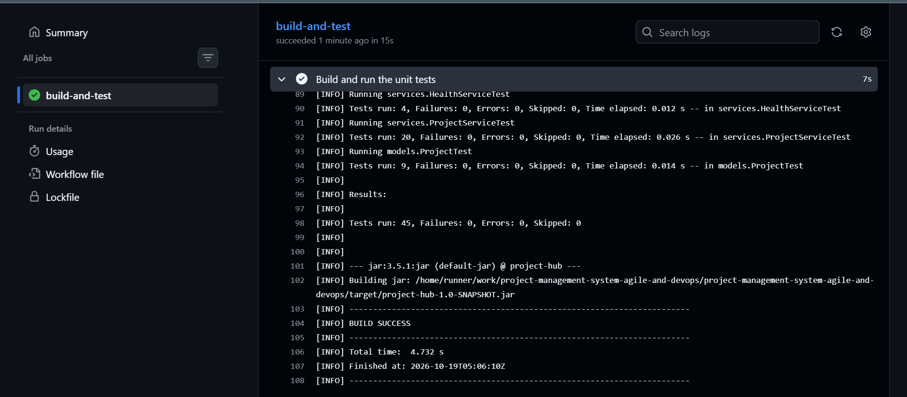
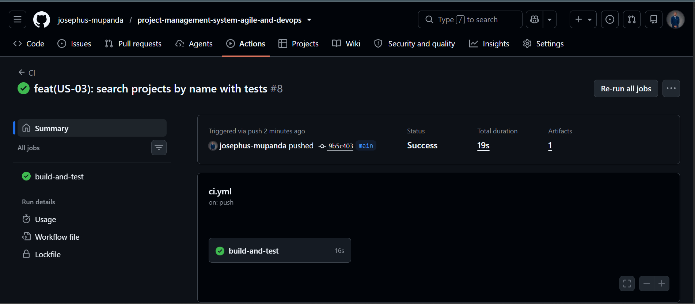
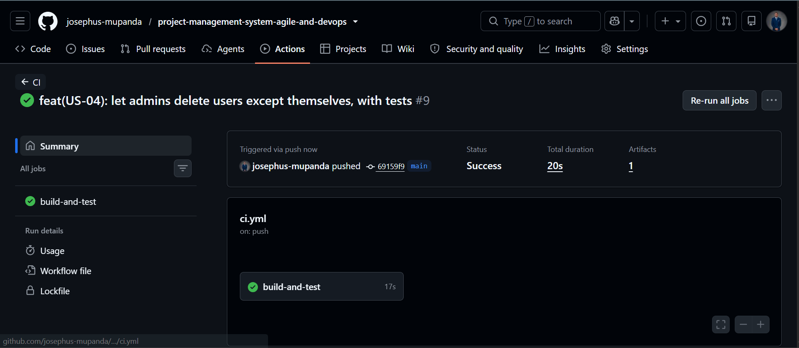

# Sprint 2 – Review

**Sprint goal:** make the application observable (logs, error tracking, health check) and complete user and project management, applying the improvements from the Sprint 1 retrospective.

**Result:** goal reached. 8 of 8 committed story points delivered, plus the `UserService` improvement item.

## Delivered items

| Item | Points | Status |
|---|---|---|
| A2 – Move users into `UserService` with tests | – | Done |
| US-03 – Search projects by name | 2 | Done |
| US-04 – Delete a user | 3 | Done |
| US-05 – Logging and health check | 3 | Done |

## Acceptance criteria check

### US-03 – Search projects by name

| # | Criterion | Result |
|---|---|---|
| 1 | Partial match ignoring case | Passed: `garden` finds "Smart Garden Monitor" |
| 2 | No match shows "No projects found." | Passed: `rocket` |
| 3 | Empty text is asked again | Passed: `Error: Search text cannot be empty.` |

### US-04 – Delete a user

| # | Criterion | Result |
|---|---|---|
| 1 | Admin deletes a user after confirming with `y` | Passed: `User "Josephus Mupanda" deleted.` |
| 2 | The logged in user cannot be deleted | Passed: `Error: You cannot delete the user you are logged in as.` |
| 3 | Unknown ID shows "User not found." | Passed: `U099` |
| 4 | A regular user gets "Access denied" | Passed |

### US-05 – Logging and health check

| # | Criterion | Result |
|---|---|---|
| 1 | Every create, update and delete writes a line to `logs/app.log` | Passed (see log extract below) |
| 2 | An unexpected error is logged as `SEVERE`, the program does not crash and returns to the main menu | Passed: proven by the integration test `ConsoleMenuTest`, which makes a service fail on purpose |
| 3 | "System Health" shows status, uptime, projects, users and errors | Passed (see screen below) |
| 4 | The `logs` folder is created automatically | Passed: deleted the folder, started the app, folder and file were created |

## Demo script

1. Start the app → `1. Manage Projects` → `1. Browse Project Catalog` → `5. Search by Name` → type `garden`.
2. Back to the main menu → `2. Manage Users` → `3. Delete a user` → `U001` (refused: logged in user) → `U002` → `y`.
3. Back to the main menu → `3. System Health`.
4. Exit with `4`, then open `logs/app.log` to show every action that was recorded.

## Monitoring evidence

**System Health screen:**

```
Status:             UP
Uptime:             0h 00m 00s
Projects:           5
Users:              2
Errors since start: 0
Log file:           logs/app.log
```

**Extract of `logs/app.log` after a demo session:**

```
2026-10-19 07:02:09 INFO    Application started with 5 projects and 2 users
2026-10-19 07:02:10 INFO    Project created: PRJ006 "Robot Arm" by Admin
2026-10-19 07:02:10 INFO    Project updated: PRJ006 "Robot Arm" by Admin
2026-10-19 07:02:10 INFO    Project deleted: PRJ006 "Robot Arm" by Admin
2026-10-19 07:02:19 INFO    Switched user to U002 "Josephus Mupanda"
2026-10-19 07:02:19 WARNING Access denied: Josephus Mupanda tried to delete projects
2026-10-19 07:04:48 INFO    Health check viewed: status UP
2026-10-19 07:04:48 INFO    Application stopped
```

## Testing evidence

| Test class | Type | Tests | Result |
|---|---|---|---|
| `models.ProjectTest` | Unit | 9 | All passed |
| `services.ProjectServiceTest` | Unit | 20 | All passed |
| `services.UserServiceTest` | Unit | 10 | All passed |
| `services.HealthServiceTest` | Unit | 4 | All passed |
| `utils.AppLoggerTest` | Integration (writes the real log file) | 1 | All passed |
| `utils.ConsoleMenuTest` | Integration (real menu with typed input) | 1 | All passed |
| **Total** | | **45** | **0 failures, 0 errors** |

From 26 tests at the end of Sprint 1 to 45 at the end of Sprint 2.



## CI/CD evidence

Every push in Sprint 2 was green. The smoke test step was updated when "Exit" moved from option 3 to option 4.

| Story | CI run |
|---|---|
| US-03 |  |
| US-04 |  |

## Commit history for the sprint

| Commit | Message |
|---|---|
| `e7d173c` | refactor: move user management from ConsoleMenu to a tested UserService |
| `9b5c403` | feat(US-03): search projects by name with tests |
| `69159f9` | feat(US-04): let admins delete users except themselves, with tests |
| `c398ef0` | feat(US-05): add file logging and error tracking in the main menu |
| `29c345b` | feat(US-05): add System Health screen with status, uptime and error count |

## Velocity

| Sprint | Committed | Delivered |
|---|---|---|
| Sprint 1 | 8 points | 8 points |
| Sprint 2 | 8 points | 8 points |

## Product backlog after Sprint 2

| ID | Story | Status |
|---|---|---|
| US-01 to US-05 | | Done |
| US-06 | Assign an owner to a project | Not started |
| US-07 | Save projects and users to a file | Not started |
