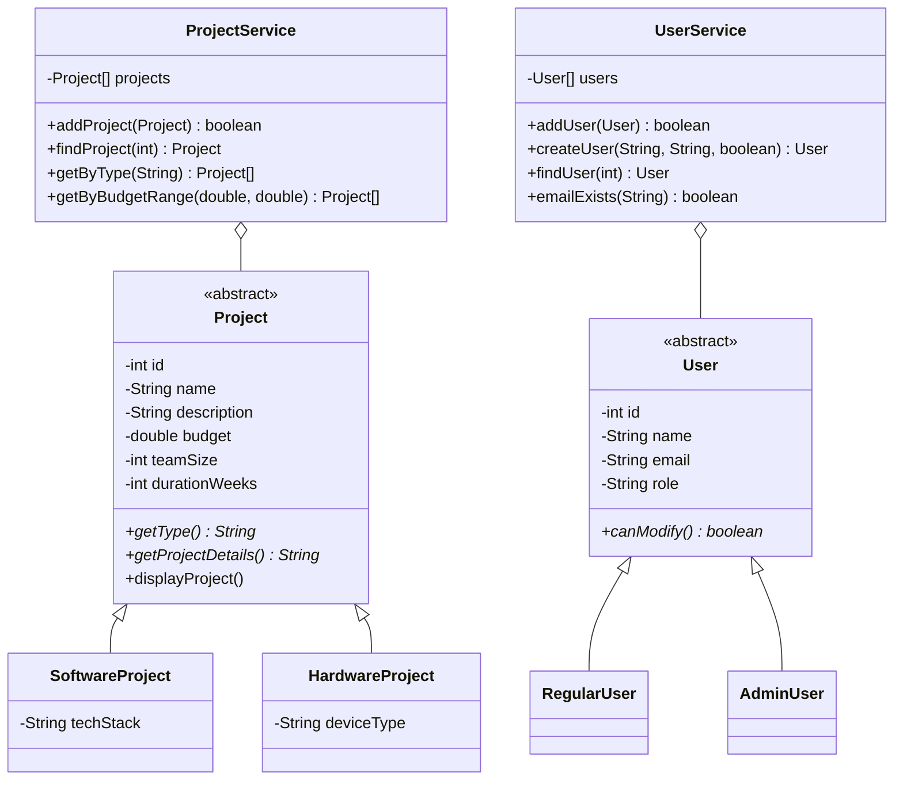

# Design decisions

This page explains why the code is built the way it is.

## Contents

1. [Class diagram](#class-diagram)
2. [Scope reduction](#scope-reduction)
3. [Inheritance and abstract classes](#inheritance-and-abstract-classes)
4. [Polymorphism](#polymorphism)
5. [Encapsulation](#encapsulation)
6. [Arrays instead of collections](#arrays-instead-of-collections)
7. [IDs](#ids)
8. [Layers: menu, services, models](#layers-menu-services-models)
9. [Role rules](#role-rules)
10. [Monitoring: logging, error tracking and health](#monitoring-logging-error-tracking-and-health)
11. [Known limits and next steps](#known-limits-and-next-steps)

## Class diagram

## Scope reduction

The first version also had tasks, task status, completion rates and status reports. For this assessment the product is reduced to **users and projects**: the goal is to show Agile and DevOps practice, not a large product. Removing tasks also removed the `Completable` interface, the `StatusReport` model and the `TaskService` and `ReportService` classes, since they only existed for tasks.

## Inheritance and abstract classes

`Project` and `User` are abstract because a plain "project" or "user" never exists on its own here. Each one is always a specific kind.

**Project** holds what every project shares: id, name, description, budget, team size and duration in weeks. Two methods are left abstract, so every subclass must answer them:

| Method | `SoftwareProject` | `HardwareProject` |
|---|---|---|
| `getType()` | `Software` | `Hardware` |
| `getProjectDetails()` | `Tech Stack: ...` | `Device Type: ...` |

**User** forces each subclass to define `canModify()`. `AdminUser` returns true and `RegularUser` returns false. The menu never asks "is this an admin?", it just asks the user object.

## Polymorphism

- `displayProject()` is written once in `Project` and calls `getType()`, so it prints the right type for every subclass.
- The catalog loops over an array of `Project` and never needs to know which concrete class each one is.
- Role checks go through `canModify()`, so adding a new role later means adding a class, not editing every menu.

## Encapsulation

- Every field in every model is private.
- IDs are `final` and have no setter, so they cannot change after creation.
- `getProjects()` returns a trimmed copy of the array, so other code cannot damage the internal one.

## Arrays instead of collections

Projects and users are stored in arrays that double in size when full. Each owner keeps a counter next to its array and only reads up to that counter, so loops do not need null checks. Searching is a simple loop, which is fine for this amount of data.

## IDs

Each class keeps a `static` counter that goes up every time an object is created, so IDs are unique for the whole run.

| Object | Stored as | Shown as |
|---|---|---|
| Project | 1, 2, 3 | PRJ001, PRJ002, PRJ003 |
| User | 1, 2, 3 | U001, U002, U003 |

`ValidationUtils.readId` accepts `PRJ001`, `prj001` or `1`.

## Layers: menu, services, models

- **Models** hold data and the rules that belong to the data.
- **Services** hold the operations across several objects (search, filter, duplicate checks). They never read from the keyboard.
- **ConsoleMenu** decides what is printed next and which screen follows.
- **ValidationUtils** is the only class that reads raw input, so every prompt keeps asking until the value is valid.

Users used to be stored inside `ConsoleMenu`, which made them impossible to unit test. In Sprint 2 (retrospective action A2) they moved to `UserService`. The menu now only keeps who is logged in (`currentUser`), which is session state, not data.

## Role rules

Regular users can view and add projects. Only admins can create users. The check is in one small method, `requireModifyAccess`, so the rule is easy to find and change.

## Monitoring: logging, error tracking and health

- **`AppLogger`** wraps Java's built-in `java.util.logging`, so no library is needed. It writes to `logs/app.log` and not to the console, because log lines in the middle of a menu would make it hard to read.
- **Error tracking** sits in one place: the `try/catch` around the main menu loop. Any unexpected error inside any screen ends there, is logged with its stack trace and counted, and the user goes back to the main menu.
- **`HealthService`** is the console version of a health endpoint. The status is `DEGRADED` as soon as one unexpected error happened, so a problem stays visible even if the user did not notice the message.
- Actions are logged in `ConsoleMenu` and not in the services, because only the menu knows who is logged in, and logging in the services would also log the sample data loaded at start.

## Known limits and next steps

| Limit now | Planned direction |
|---|---|
| Nothing is saved when the program closes | Save to files (US-07) |
| Switching user needs no password | Add authentication |
